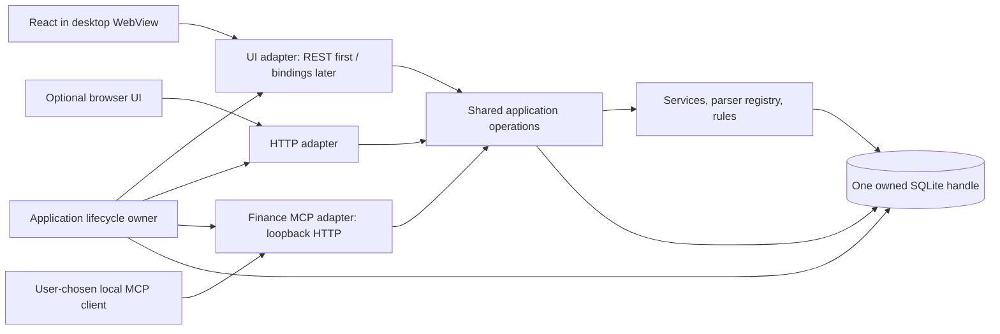

# Native desktop application analysis with MCP

Revisited 12 October 2026; supersedes the recommendation researched on 7 October. Scope: a desktop window for the existing React/Go/SQLite application, now accounting for LocalFinance's implemented MCP integration. The comparison below records the research; the later Wails decision and implementation are linked in the decision update.

## Recommendation

**A desktop application is feasible, and MCP makes process ownership and background operation more valuable. Keep one Go application owning the database, with a desktop UI and the existing optional finance MCP listener alongside it.** MCP changes the architecture priorities; it does not require a particular desktop framework or a rewrite of finance logic.

The earlier conclusion was too narrow: Wails still conflicts with the mandatory CGO-free macOS/Linux build policy, but a newer candidate, **Glaze**, explicitly targets CGO-free native WebViews through `purego`, using system browser engines without bundled native libraries. That makes it worth a bounded feasibility prototype under the current policy. This is a maintainer claim and source-backed candidate, not evidence that LocalFinance already works on it. [Glaze project](https://github.com/crgimenes/glaze)

**Decision update, 12 October:** the user selected **Wails v3** and authorized CGO for the desktop shell. The prototype has been promoted to a desktop host with packaging and CI. See [desktop approach and run instructions](../../cmd/desktop/README.md) and [release readiness gates](../desktop-release.md). Windows/Linux runtime validation is still pending. The portable server remains CGO-free.

Recommended decision order after that decision:

1. Prototype the pinned Wails v3 beta around the existing React interface and Gin API. Keep finance MCP in the same database-owning process.
2. Validate the desktop lifecycle and supported platforms before adopting native bindings or release packaging.
3. Extract shared operations incrementally where Gin handlers still own business behavior. Existing service, parser and database packages already provide the reusable implementation; a separate public library is unnecessary.

Wails remains the closest higher-level fit to the Go/React stack: it hosts the frontend in a native window and provides Go bindings. This means an OS-native window containing React controls, rather than a rewrite as platform-native widgets. [Wails architecture](https://v2.wails.io/docs/howdoesitwork/)

## What has changed in the repository

These are observations from the current source, not inferred framework capabilities:

| Area | Current implementation | Desktop implication |
| --- | --- | --- |
| Startup | `cmd/server/main.go` opens one database, creates `TransactionService` and an MCP `Manager`, then starts the Gin application | Reuse this composition in the desktop entrypoint |
| UI | Embedded React SPA; browser opens against `127.0.0.1:8080`, with a random-port fallback | A WebView can initially consume the same routes |
| Finance MCP | `internal/mcp/server.go` serves stateless JSON Streamable HTTP on its own configured loopback port, default `8081` | Removing browser launch or UI HTTP does **not** remove the MCP listener |
| Permissions | Disabled by default; hashed bearer credential; read access plus separate opt-in category/rule and statement/investment write permissions | Preserve the same access model and existing client configuration |
| UI lock | MCP token remains valid while the UI is locked; it cannot authenticate management or REST UI sessions | A native UI must preserve this distinction or deliberately specify a behavior change |
| Mutation behavior | Rule saves atomically reapply categories; statement CSV import reuses transaction ingestion; upload deletion is destructive | Reuse operations and announce committed changes to UI caches |
| Revocation | Disable/rotation/reset/restore stop or restart the listener; reset/restore revoke and drain requests before replacing data | Desktop quit/update must use the same coordination |
| Toolchain | `go.mod` now declares Go 1.27.2 and MCP Go SDK v1.7.0 | The previous Go-version reference is stale |

MCP is already substantially more than a read-only reporting endpoint. Category and rule writes and statement/investment uploads are separately enabled. CSV uploads require an absolute regular local file, reject symlinks/network paths and have a 20 MiB limit; investment uploads accept supported original workbooks up to 10 MiB. Preserve these contracts rather than broadening access to arbitrary files. Current semantics are documented in [README MCP guidance](../../README.md#ai-tools-and-mcp-opt-in) and [CSV import design](../mcp-ledger-imports.md), with implementation in `internal/mcp/`.

The current `.app`/DMG wraps the server executable, so launching it still opens a browser. Closing a tab does not quit the server. A desktop shell would give the application an owned window, menus, dialogs, activation and explicit quit behavior. Navigation and information architecture remain a separate UX task.

## Framework options revisited

| Option | Reuse and integration | Current policy fit | Assessment |
| --- | --- | --- | --- |
| Glaze | Go native WebView; existing HTTP handler first, narrow Go bindings later | Advertises CGO-free builds and no bundled native library; OS WebView prerequisites remain | First feasibility candidate; platform and maintenance risks require proof |
| Wails v2 | React + Go in one application, generated frontend bindings | macOS/Linux window implementations use C bindings | Best conditional higher-level baseline if desktop CGO becomes acceptable |
| Wails v3 | Go services, richer desktop APIs; optional developer MCP control tooling | macOS/Linux require CGO; still beta | Evaluate separately; existing finance MCP does not require it |
| Tauri v2 + Go sidecar | React UI plus Rust shell and bundled Go process | Go can remain CGO-free, but full application has multiple executables/toolchains | Viable alternate packaging model, higher integration cost here |
| Electron + Go process | React UI with bundled Chromium/Node and Go child | Changes portable single-binary distribution | Useful if browser consistency becomes the priority; measure size/memory |
| Browser application / Chromium app window | Existing server and UI remain | Preserves current Go artifact | Reliable fallback; depends on installed browser and launcher coordination |

### Glaze: promising policy fit, explicit release risks

Glaze provides JavaScript bindings, native file dialogs, menus and embedded-asset custom schemes. Linux still requires GTK/WebKitGTK runtime libraries; macOS uses WKWebView and Windows uses WebView2. Its README says Linux GUI tests can skip when dependencies are absent: a green package test cannot prove the window runs. [Glaze capabilities and prerequisites](https://github.com/crgimenes/glaze)

Its `AppWindow` accepts an `http.Handler`, starts a local server and owns the window loop. The default Unix-socket transport on macOS/Linux also has a loopback HTTP gateway, so it does **not** eliminate listening TCP ports. Window exit closes its UI HTTP server. For LocalFinance, the first spike should explicitly use the direct loopback TCP transport to reduce transport changes; application-level shutdown must still stop MCP and close SQLite. [AppWindow source](https://raw.githubusercontent.com/crgimenes/glaze/trunk/appwindow.go)

Two material risks affect adoption:

- **Windows runtime compatibility:** to avoid a bundled loader DLL, Glaze invokes an undocumented WebView2 environment-creation export. That can change with the installed runtime; assess the fallback/support burden before relying on it for financial software. [Windows backend](https://raw.githubusercontent.com/crgimenes/glaze/trunk/webview2_windows.go)
- **Release maturity:** GitHub lists no published releases, although the Go package index contains pre-1.0 tags, including v0.0.76. Pin a reviewed tag/commit, inspect maintenance practices, and assess whether a fork is acceptable. Source activity does not establish stable compatibility. [Glaze releases](https://github.com/crgimenes/glaze/releases), [Go package index](https://pkg.go.dev/github.com/crgimenes/glaze)

This candidate corrects the earlier claim that only a browser launcher could preserve CGO-free distribution. It does not establish cross-platform readiness. An OS WebView may also spawn browser-engine processes; “one application owner” refers to LocalFinance's database/service owner, not an assertion that the operating system runs exactly one process.

### Wails: stable baseline versus beta features

The current v2 documentation identifies version 2.15.0. Its platform prerequisites include Windows WebView2 and Linux GTK/WebKit; macOS and Linux frontend source imports C. [v2 installation](https://v2.wails.io/docs/gettingstarted/installation/), [v2 macOS implementation](https://github.com/wailsapp/wails/blob/v2.15.0/v2/internal/frontend/desktop/darwin/frontend.go), [v2 Linux implementation](https://github.com/wailsapp/wails/blob/v2.15.0/v2/internal/frontend/desktop/linux/frontend.go)

Wails v3's official status remains **beta**. The desktop baseline is Go 1.25+, with Linux GTK4/WebKitGTK 6.0 by default and a legacy GTK3 option. Its build guide explicitly requires CGO on macOS and Linux; Windows can use CGO-free builds. Cross-compilation tooling does not remove that constraint. [v3 status](https://v3.wails.io/status/), [v3 build requirements](https://v3.wails.io/guides/build/cross-platform/)

A relevant new distinction: **Wails v3's experimental MCP server is developer automation, not LocalFinance's finance MCP.** It can inspect DOM, evaluate JavaScript, simulate input and call bound Go methods. Wails recommends omitting the `mcp` build tag in production. If used for a development spike, keep it restricted to disposable data and an authenticated local client; release CI must exclude it. Keep `internal/mcp` as the production finance interface with its curated tools and permissions. [Wails LLM Control documentation](https://v3.wails.io/guides/mcp-service/)

### Tauri, Electron and browser fallback

Tauri supports external sidecar binaries with target-triple-specific filenames. A Go sidecar can retain the backend and its CGO-free build, but introduces Rust/Go IPC, process health, ownership, shutdown and signing coordination. Native build tools and system WebView prerequisites still apply. MCP can stay in the Go owner process; putting it in Rust adds no clear benefit here. [Tauri sidecars](https://v2.tauri.app/develop/sidecar/), [Tauri prerequisites](https://v2.tauri.app/start/prerequisites/)

Electron brings its Chromium/Node process model and native desktop facilities. If chosen, isolate a narrow preload bridge, enable context isolation and sandboxing, and treat privileged IPC as an authorization boundary. Its distribution and memory cost for LocalFinance must be measured, not guessed. [Electron process model](https://www.electronjs.org/docs/latest/tutorial/process-model), [Electron security](https://www.electronjs.org/docs/latest/tutorial/security)

A Chromium application window remains an incremental fallback. It can hide browser chrome but depends on a browser installation and does not reliably make browser process exit equal window close. A PWA similarly cannot start the Go service by itself; random-port fallback also complicates saved origins. These launcher approaches leave MCP availability tied to the server lifetime. [Chromium app switch](https://chromium.googlesource.com/chromium/chromium/%2B/master/chrome/common/chrome_switches.cc), [PWA installation requirements](https://developer.mozilla.org/en-US/docs/Web/Progressive_web_apps/Guides/Making_PWAs_installable)

## Proposed shared architecture

This is a recommendation derived from the repository, not something MCP requires:

**Keep the UI and MCP as separate adapters over shared operations.** MCP tools are paginated, masked, permission-limited agent operations; the UI needs settings, dialogs, backup, restore and more detailed views. Making React an MCP client would add token handling and protocol overhead while still failing to cover the UI surface.

Initially reuse the current Gin router inside the native window. This provides a desktop application without immediately replacing REST. After the shell proves itself, extract a narrow application facade for operations now spread across `internal/api/handlers.go`, `internal/mcp/`, services and database methods. Both adapters should reuse validation and transactions, but retain their distinct credentials, masking and permission rules. A raw `*db.DB` must never be reflected into a JavaScript bridge.

Later native Go bindings can replace UI HTTP through `frontend/src/lib/api.ts` while retaining React Query hooks and components. Audit backup/CSV/JSON links under `/api/database/`, `window.open`, reload and location-dependent behavior outside that file. Bind only a reviewed UI facade; native transport does not imply all privileged methods are available while locked.

### Database ownership, background mode and quit

Preserve the existing `~/.localfinance/local_finance.db` default, current-directory fallback when home lookup fails, explicit `-db` override and disposable development path. Do not silently switch to a framework-specific data directory. Preserve migrations, WAL, busy timeout, connection limits, and the exact transaction fingerprint/upsert behavior.

The database's single-writer pool is scoped to a process/handle. Starting a desktop app and an independent MCP daemon against the same file would create separate owners, migration/restore races and competing caches, even though SQLite supports locking. **Choose one owner per database path.** Re-launch should activate the existing window, while competing server/desktop launches must hand off or report ownership clearly. An occupied MCP port alone is insufficient proof that the same database is already owned.

Recommended initial behavior: closing the window quits the application, with clear notice that MCP also stops. Add an explicit “Keep running for AI connections” preference only after basic desktop release gates pass. When enabled, close hides the window and a visible tray/menu action reopens or quits it. Avoid invisible automatic background processes or login startup in the first release.

Full quit, restore, reset and update must stop admission of new work, cancel/drain active MCP and UI operations, finish or safely interrupt imports, then close/replace the database. A cancellation after a mutation commits is not a rollback. Preserve success semantics and avoid blind retries of non-idempotent writes. Distinguish listener failures from application failures and retain the configured MCP port rather than silently switching clients to a random endpoint.

### External writes must refresh the UI

`frontend/src/main.tsx` currently sets a one-minute stale time and disables refetch on window focus. A rule save or upload performed through MCP can therefore leave mounted UI views displaying old data.

Emit a local domain-change event **after a successful commit** from the shared mutation operation. The desktop adapter can forward it through a Go/JavaScript event bridge and invalidate relevant React Query keys: ledger, accounts, categories/rules, reports, import history and investments as appropriate. For optional browser mode, choose a local event stream or bounded refresh strategy. Start with broad invalidation if safer, then narrow it based on measured needs. Do not mistake MCP protocol tool-list notifications for data-cache invalidation.

## MCP transport and privacy decisions

**Retain Streamable HTTP as the first supported transport.** MCP defines both stdio (client launches a server subprocess) and Streamable HTTP (independently running server, multiple clients). The latter already matches a desktop owner serving several local clients. Keep existing endpoint URLs, headers, tool schemas, limits and write scopes. [MCP transport specification](https://modelcontextprotocol.io/specification/2025-11-25/basic/transports)

Local HTTP requires localhost-only binding, Origin validation and authentication. Preserve the existing Host checks, token hashing, revocation and separate management session. A stateless JSON response mode does not remove authorization requirements. [MCP transport security requirements](https://modelcontextprotocol.io/specification/2025-11-25/basic/transports)

**Defer stdio until a concrete client needs it.** If added, prefer a small stdio-to-existing-owner bridge, with explicit credentials and the same permission enforcement. It should not open SQLite or enable MCP automatically. Diagnostics must stay on stderr; stdout is reserved for protocol messages. Client EOF/termination should stop the bridge, not kill the desktop owner. Automatically starting the desktop application is a further opt-in behavior requiring readiness, instance coordination and platform testing. [MCP stdio transport](https://modelcontextprotocol.io/specification/2025-11-25/basic/transports), [MCP shutdown lifecycle](https://modelcontextprotocol.io/specification/2025-11-25/basic/lifecycle)

Keep finance credentials distinct from UI sessions. If future stateful HTTP is needed, session IDs must not become authentication credentials. Avoid passing a LocalFinance token to model providers or unrelated APIs. [MCP security guidance](https://modelcontextprotocol.io/docs/2025-11-25/tutorials/security/security_best_practices)

The privacy boundary remains crucial:

- LocalFinance computes and stores locally and does not call a model provider. Its existing opt-in MCP server exposes selected data to a client running on the same machine.
- That client may transmit returned data to a cloud model. A local connection and native window do not make cloud inference offline. Locking the UI or blurring balances does not revoke existing MCP access or recall delivered data.
- A fully local model/client is possible independently of the shell, subject to its own setup and network behavior. It need not be bundled into LocalFinance.
- A cloud-only client cannot directly reach `127.0.0.1`. Do not introduce tunnels, remote MCP hosting or cloud proxies under the current product policy.

These are existing product semantics described in [README](../../README.md#ai-tools-and-mcp-opt-in). Native distribution should preserve the user-facing disclosure and defaults. An in-app cloud chat feature would require changing the offline product policy and is outside this recommendation.

## Phased approach and decision gates

### Phase 1: test the selected Wails v3 shell

Create an isolated desktop entrypoint around the pinned Wails v3 beta with the existing Gin handler, one database owner and the existing MCP Manager. Keep `cmd/server` and its portable build. Pin the candidate dependency; use `pnpm` for frontend commands. Use a disposable copy of the database and retain current MCP settings semantics. No frontend rewrite is needed for the first proof.

Require an actual window on macOS Intel/ARM64, Windows and Linux; CGO-free server builds on all required targets, with CGO allowed for the desktop shell; offline launch on machines with documented WebView prerequisites; import/re-import, settings, authentication, charts, scrolling and file downloads. Specifically test Windows across supported WebView2 runtime versions and Linux on declared distributions. Successful cross-compilation or skipped GUI tests are insufficient evidence.

**Go/no-go:** adopt Wails v3 only if platform checks, data preservation, lifecycle behavior and the beta maintenance burden are acceptable. Retain the portable server/browser artifact throughout. The user-authorized desktop CGO exception does not require changing SQLite or making the server depend on Wails.

### Phase 2: make desktop ownership reliable

Implement per-database instance coordination, activation, native dialogs, quit/import coordination and committed-change invalidation. Keep default quit behavior simple. Add optional background mode with clear MCP status and explicit quit. Ensure reset/restore drain both UI and MCP operations and clear credentials/write scopes.

**Go/no-go:** demonstrate that two launch paths cannot independently migrate/restore the same database, that MCP stops on full quit/revocation, and that an MCP write refreshes the visible UI without reload.

### Phase 3: improve adapters and ship packaging

Extract shared application operations as needed and migrate UI transport incrementally only where it helps. Retain the separate finance MCP adapter and optional browser mode. Rewrite update shutdown/relaunch for desktop behavior: current `-open=false` server restart assumptions can produce an invisible desktop process. Validate signed bundle replacement and matching desktop/server artifacts rather than replacing only the current executable indiscriminately.

Ship per-platform metadata, icons, signing/notarization and documented runtime prerequisites. Support offline runtime provisioning; Windows WebView2 offers a standalone offline installer, and its runtime must be checked rather than assumed present. [Microsoft runtime distribution](https://learn.microsoft.com/en-us/microsoft-edge/webview2/concepts/distribution) Preserve GitHub Releases as the application's sole external check, including the four-hour cache, opt-out and on-demand behavior. Evaluate stdio or a dedicated background owner only after a demonstrated need.

## Verification and evidence limits

Future implementation checks should cover duplicate imports, preservation of categories/manual tags/notes, investment snapshots, backup/restore, locked/unlocked UI with independent MCP access, permission toggles, token rotation, port conflict, external-write refresh, close/hide/quit, concurrent launch and update relaunch. Use disposable data. Run affected Go tests, `pnpm lint` and `pnpm build`, plus the required `CGO_ENABLED=0` build matrix for retained portable artifacts and any candidate claimed to satisfy that policy.

This revision checked repository entrypoints, MCP implementation, ingestion/build/dependency files, frontend cache defaults and official sources linked beside the claims. Framework choice is an architectural recommendation; release size, memory, accessibility, runtime compatibility and operational reliability remain unmeasured until a prototype. No framework was installed and no application tests were run for this documentation-only change.
